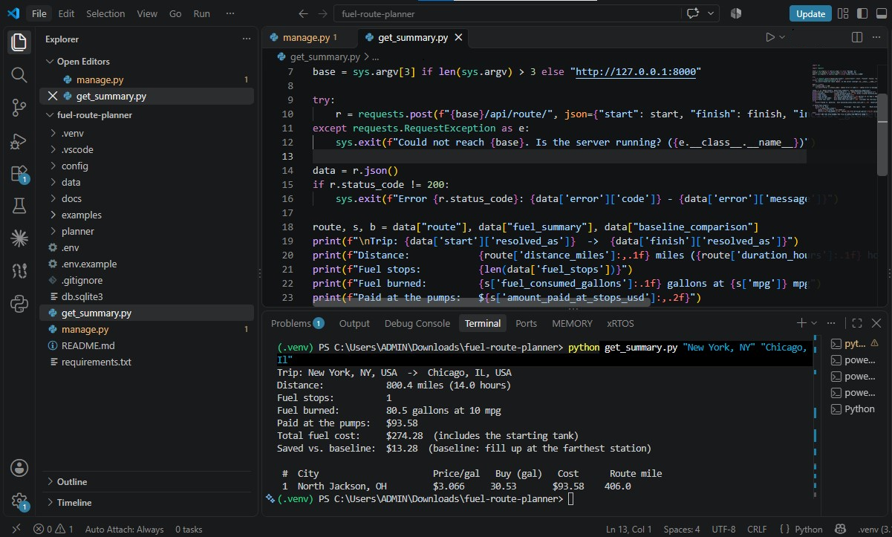
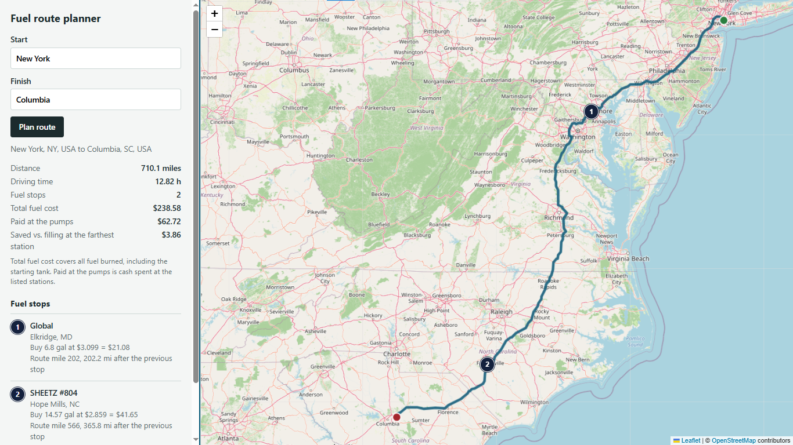

<div align="center">

# ⛽ Django Fuel Route Optimizer API
### Cost-Optimal Fuel Stops for USA Road Trips — Django REST Framework · OpenRouteService · Leaflet

[](https://www.python.org/)
[](https://www.djangoproject.com/)
[](https://www.django-rest-framework.org/)
[](https://openrouteservice.org/)
[](https://leafletjs.com/)
[](https://www.openstreetmap.org/)
[]()
[]()

<br>

> *"The cheapest fuel is not the cheapest stop — price, range and detour have to be weighed together."*

<br>

**Author:** Umer Ahmed Baig Mughal <br>
**Project type:** Backend REST API · Route Optimization · Geospatial Data <br>
**Focus areas:** Django REST Framework · Dynamic Programming · Fuel Cost Optimization · GeoJSON · OpenStreetMap Mapping <br>
**Background:** MSc Robotics and Artificial Intelligence — ITMO University

</div>

---

<div align="center">





</div>

---

## 📋 Table of Contents

- [📖 About This Repository](#-about-this-repository)
- [📁 Repository Structure](#-repository-structure)
- [🔬 Overview — How the Pipeline Works](#-overview--how-the-pipeline-works)
- [🧪 Component Summaries](#-component-summaries)
  - [🔵 Stage 1 — Fuel Data: Cleaning, Merging & Station Placement](#-stage-1--fuel-data-cleaning-merging--station-placement)
  - [🟠 Stage 2 — Routing: OpenRouteService, Geocoding & Caching](#-stage-2--routing-openrouteservice-geocoding--caching)
  - [🟣 Stage 3 — Corridor Search: Finding Stations Near the Route](#-stage-3--corridor-search-finding-stations-near-the-route)
  - [🟢 Stage 4 — Optimizer: Dynamic Programming for Fuel Stops](#-stage-4--optimizer-dynamic-programming-for-fuel-stops)
  - [🔴 Stage 5 — Cost Accounting & Baseline Comparison](#-stage-5--cost-accounting--baseline-comparison)
  - [🟡 Stage 6 — Rendered Map Page: Leaflet & OpenStreetMap](#-stage-6--rendered-map-page-leaflet--openstreetmap)
- [🔗 Request Lifecycle](#-request-lifecycle)
- [🌐 API Reference](#-api-reference)
- [🔧 Technical Specifications](#-technical-specifications)
- [🚀 Getting Started](#-getting-started)
- [📊 Key Results Summary](#-key-results-summary)
- [🧠 Analysis and Discussion](#-analysis-and-discussion)
- [🚧 Notes and Limitations](#-notes-and-limitations)
- [🧰 Tech Stack](#-tech-stack)
- [👤 Author](#-author)
- [📄 License](#-license)

---

## 📖 About This Repository

**Django Fuel Route Optimizer API** is a Django REST Framework service that plans road trips across the contiguous USA around the price of fuel. Send a **start** and a **finish**; it returns the **driving route**, the **most cost-effective fuel stops** along it, the **total fuel cost** for a vehicle with a **500-mile range** and **10 miles per gallon**, and an **interactive Leaflet / OpenStreetMap map** of the whole plan.

Routing and geocoding use the free **OpenRouteService** API (OpenStreetMap data), with **one directions request per trip**. Fuel prices come from a supplied CSV of truck-stop prices, which is cleaned, merged and placed on the map locally — never one external call per station.

The unifying idea is that **a good fuel stop is a trade-off, not a lookup**: the cheapest station may be 400 miles away, or 30 miles off the route. A dynamic-programming optimizer weighs price against the 500-mile range and the fuel burned on detours, and every result is compared against a simple "fill up at the farthest station" baseline.

### 🎯 What You Will Find Here

| 📁 Component | 🏷️ Topic | 🧠 Core Concept | 🛠️ Key Tools |
|:------------:|:--------:|:---------------:|:-------------:|
| Data | Fuel price CSV cleaning | Drop non-US rows · validate prices · merge duplicate IDs · ZIP-centroid placement | `csv` · `zipcodes` |
| Routing | Route + geocoding | One OpenRouteService directions call · caching · typed error mapping | `requests` · Django cache |
| Search | Stations near the route | 2-mile route resampling · grid index · detour distance | Pure Python |
| Optimizer | Choosing fuel stops | Dynamic programming over (station, fuel level) · exact gallons · pointless-stop pruning | Pure Python |
| Cost | Fuel cost accounting | Cash paid vs. fuel burned · starting-tank valuation · baseline comparison | Pure Python |
| Map | Rendered route map | Leaflet map · numbered stop pins · GeoJSON output | Leaflet · OpenStreetMap |

---

## 📁 Repository Structure

```
📦 django-fuel-route-optimizer/
│
├── 📄 README.md                               # ← You are here
├── 📄 manage.py
├── 📄 get_summary.py
├── 📄 requirements.txt                        # pinned versions
├── 📄 .env.example                            # copy to .env and add your ORS key
├── 📄 .gitignore
│
├── 📁 config/                                 # Django project: settings, urls, wsgi
│
├── 📁 planner/                                # the application
│   ├── 📄 stations.py                         # CSV loading, cleaning, city lookup
│   ├── 📄 geo.py                              # distances, route resampling, grid index
│   ├── 📄 routing.py                          # OpenRouteService client, caching, errors
│   ├── 📄 optimizer.py                        # candidates, stop-selection DP, pricing, baseline
│   ├── 📄 services.py                         # plan_trip(): the whole flow + response
│   ├── 📄 serializers.py · views.py · urls.py · exceptions.py
│   ├── 📁 templates/planner/map.html          # Leaflet map page
│   ├── 📁 management/commands/inspect_fuel_data.py
│   └── 📁 tests/                              # 97 offline tests
│
├── 📁 data/
│   └── 📊 fuel-prices-for-be-assessment.csv   # fuel price dataset
│
├── 📁 output/
│   ├── 🖼️ route-map.png                       # screenshot of the rendered map
│   ├── 🖼️ route-map1.png
│   ├── 🖼️ route-summary.png                   # screenshot of the route summary
│   └── 🖼️ route-summary1.png                   
│
├── 📁 docs/
│   ├── 📄 DESIGN.md                           # algorithm and trade-off notes
│   └── 📄 postman_collection.json             # importable Postman requests
│
└── 📁 examples/                               # request bodies + SIMULATED example responses
```

---

## 🔬 Overview — How the Pipeline Works

Every request flows through five deliberate stages, each doing one job and handing a clean result to the next. A sixth piece, the browser map page, draws the finished response.

**Stage 1 — Clean the fuel data:** The CSV has no coordinates, so each US station is placed at its city's ZIP-code centroid using offline data. Canadian rows, invalid prices and duplicate station IDs are handled up front, once per process.

**Stage 2 — Route:** One OpenRouteService directions call returns the road geometry and distance. Place names are geocoded (at most two extra calls; none if you send `"lat,lon"`). Results are cached.

**Stage 3 — Search the corridor:** The route is resampled every 2 miles into a grid, so each station finds its nearest route point — giving its position along the route and its distance from it. Only stations within 10 miles are used (widened to 25, then 40, only if no plan is possible).

**Stage 4 — Optimize:** Dynamic programming picks the cheapest chain of stops that never exceeds 500 miles per leg, counting detour fuel. A second pass computes the exact gallons to buy at each stop.

**Stage 5 — Cost and response:** Cash paid and fuel burned are reported separately, compared with a baseline, and returned with a GeoJSON map. **Stage 6** is the Leaflet page that renders that response in the browser.

```
  Fuel CSV              Route                 Corridor Search       Optimizer            Cost + Response
  ─────────────         ─────────────         ───────────────       ──────────────       ─────────────
  ┌─────────┐           ┌─────────┐           ┌─────────┐           ┌─────────┐          ┌─────────┐
  │ STAGE 1 │─────────► │ STAGE 2 │─────────► │ STAGE 3 │─────────► │ STAGE 4 │────────► │ STAGE 5 │
  └─────────┘           └─────────┘           └─────────┘           └─────────┘          └─────────┘
  Clean + merge         1 directions call     2-mile resample       DP over stops        Paid vs. burned
  ZIP-centroid          Geocode + cache       Grid index            Exact gallons        Baseline compare
  placement             Typed errors          Detour distance       Range ≤ 500 mi       GeoJSON map data
```

---

## 🧪 Component Summaries

---

### 🔵 Stage 1 — Fuel Data: Cleaning, Merging & Station Placement

<div align="center">

[]()
[]()
[]()
[]()

</div>

#### 📌 Task Description

> Turn a raw fuel price CSV with **no latitude or longitude** into a clean list of US stations with coordinates, without making thousands of geocoding calls.

**What this stage does:**
- **Drops non-US rows:** 620 Canadian rows (AB, BC, MB, NB, NS, ON, QC, SK, YT) are removed.
- **Validates prices:** non-numeric, zero, negative, `NaN` and out-of-band values (outside $1–$10) are discarded and counted.
- **Merges duplicate station IDs:** 678 stations appear on several rows with different prices (median spread 6¢, max 90¢). Each station is collapsed to one record (mean price by default; `min` / `max` selectable).
- **Cleans text:** collapses whitespace in names, addresses and cities.
- **Places stations on the map:** each station sits at the mean ZIP-code centroid of its city, using the offline `zipcodes` package. Placeholder `0,0` ZIP rows are ignored.
- **Reports everything:** `python manage.py inspect_fuel_data` prints rows read, dropped, merged and located.

#### 🔑 Key Concepts

| Concept | Description |
|---------|-------------|
| 🧹 Defensive CSV loading | Missing file, missing columns and zero usable rows raise a clear `fuel_data_unavailable` error |
| 🔗 ID-based merging | A station ID always maps to one address, so merging by ID is safe |
| 📍 ZIP-centroid placement | Free, offline, instant, 100% coverage — but approximate (see [Notes and Limitations](#-notes-and-limitations)) |
| ⚡ Parse once | Cached per process; startup cost is about one second |

#### 📤 Key Numerical Results

```
Dataset: fuel-prices-for-be-assessment.csv

┌──────────────────────────────┬──────────────────────────────────────────────┐
│ Result                       │ Outcome                                      │
├──────────────────────────────┼──────────────────────────────────────────────┤
│ Rows read                    │ 8,151                                        │
│ Non-US rows dropped          │ 620                                          │
│ Invalid-price rows           │ 0 (filter tested with synthetic bad rows)    │
│ Duplicate-ID rows merged     │ 905                                          │
│ Stations loaded              │ 6,626 (100% of US stations located)          │
│ Price range                  │ $2.687 – $6.399 per gallon (median $3.399)   │
└──────────────────────────────┴──────────────────────────────────────────────┘
```

---

### 🟠 Stage 2 — Routing: OpenRouteService, Geocoding & Caching

<div align="center">

[]()
[]()
[]()
[]()

</div>

#### 📌 Task Description

> Get a real driving route between two US locations using a **free** routing API, with as few external requests as possible.

**What this stage does:**
- **One directions call per trip** (`POST /v2/directions/driving-car/geojson`) returns the road geometry, distance and duration.
- **Geocodes place names** with the ORS geocoder, restricted to the USA — **skipped entirely** if you send `"lat,lon"`.
- **Caches results:** geocodes for 7 days, routes for 6 hours; repeat requests make no external calls.
- **Validates coverage:** locations must be in the contiguous USA.
- **Maps every failure to a typed error:** timeout, bad key, rate limit, 5xx, invalid JSON, no route — each with its own HTTP status and code.
- **Keeps credentials in the environment:** `ORS_API_KEY` is read from `.env`, never hard-coded.

#### 🔑 Key Concepts

| Concept | Description |
|---------|-------------|
| 🌐 OpenRouteService | Free key; documented limits: directions 2,000/day and 40/min, geocoding 1,000/day |
| 🧊 Cache keys hashed | Geocode keys are SHA-256 hashed so they are valid for memcached/Redis too |
| 🚦 Throttling | `30/min` per client by default, protecting the shared ORS quota |
| 🏷️ Attribution | `© openrouteservice.org by HeiGIT \| Map data © OpenStreetMap contributors` returned in every response |

#### 📤 Key Numerical Results

```
External calls per trip

┌──────────────────────────────┬──────────────────────────────────────────────┐
│ Input style                  │ ORS calls                                    │
├──────────────────────────────┼──────────────────────────────────────────────┤
│ Two place names              │ 3  (2 geocodes + 1 directions)               │
│ Two "lat,lon" strings        │ 1  (directions only)                         │
│ Repeat of any earlier trip   │ 0  (served from cache)                       │
└──────────────────────────────┴──────────────────────────────────────────────┘
```

---

### 🟣 Stage 3 — Corridor Search: Finding Stations Near the Route

<div align="center">

[]()
[]()
[]()
[]()

</div>

#### 📌 Task Description

> Select stations **near the route** (not the cheapest stations regardless of detour), and learn how far along the route each one sits.

**What this stage does:**
- **Resamples the route** into a point every 2 miles, scaling mile markers so the last one equals the ORS distance — keeping every later number consistent.
- **Indexes the points in a grid** (0.25° cells), so each station only checks nearby cells instead of every route point.
- **Computes two numbers per station:** `route_mile` (position along the route) and `offset` (straight-line distance from the route).
- **Prunes duplicates:** stations in the same town share a position and detour, so only the cheapest can ever win (about 300 → 136 candidates on a cross-country route).
- **Widens the corridor only when needed:** 10 → 25 → 40 miles.

#### 🔑 Key Concepts

| Concept | Description |
|---------|-------------|
| 🗺️ Route resampling | Fixed 2-mile spacing bounds position error to about 1 mile |
| 🧱 Spatial grid | Fast nearest-point lookup in pure Python — no NumPy needed |
| ↔️ Detour = 2 × offset | Round trip to the station; the fuel burned counts against the range |

---

### 🟢 Stage 4 — Optimizer: Dynamic Programming for Fuel Stops

<div align="center">

[]()
[]()
[]()
[]()

</div>

#### 📌 Task Description

> Choose where to refuel and how much to buy, minimising total fuel cost while **never planning a stretch longer than the vehicle's 500-mile range**.

**What this stage does:**
- **Step 1 — Choose stops (DP):** state = (station, fuel in the tank in quarter gallons). Moving to a later station burns fuel, including detour fuel (rounded **up**, so range is never over-promised); at a station any amount may be bought at its price. The table gives the cheapest chain of stops.
- **Step 2 — Exact gallons:** for the chosen stops, buy just enough to reach the next *cheaper* stop (or the destination); fill the tank if none is within range.
- **Step 3 — Drop pointless stops:** a stop is removed if skipping it raises the exact cost by less than `MIN_STOP_SAVING_USD` ($1.00 by default), as long as the trip stays within range.
- **Reports infeasibility clearly:** if a stretch longer than 500 miles has no station nearby, the API returns `no_feasible_fuel_plan` naming the mile range of the gap.

#### 🔑 Key Concepts

| Concept | Description |
|---------|-------------|
| 🧮 DP over (station, fuel) | Handles price/range interaction exactly — greedy "cheapest in each window" cannot |
| ⛽ Buy-to-next-cheaper rule | Exact optimal purchase for a fixed list of stops |
| 📏 Range includes detours | A leg is `offset(from) + route distance + offset(to)` and must be ≤ 500 miles |
| ✂️ Stop pruning | Stops that save pennies are removed; small top-ups that remain are structurally needed |

#### 📤 Key Numerical Results

```
Optimizer timing (measured in development on simulated routes)

┌──────────────────────────────┬──────────────────────────────────────────────┐
│ Case                         │ Outcome                                      │
├──────────────────────────────┼──────────────────────────────────────────────┤
│ 10-mile corridor, ~136 cand. │ about 0.02 s                                 │
│ 40-mile corridor, ~404 cand. │ about 0.17 s                                 │
│ Station at exactly 500 mi    │ usable (tested)                              │
│ Station at 501 mi            │ unreachable (tested)                         │
└──────────────────────────────┴──────────────────────────────────────────────┘
```

---

### 🔴 Stage 5 — Cost Accounting & Baseline Comparison

<div align="center">

[]()
[]()
[]()
[]()

</div>

#### 📌 Task Description

> Report **how much the trip costs**, distinguishing the money spent at the pumps from the cost of the fuel actually burned.

**What this stage does:**
- **Two cost numbers, on purpose:** `amount_paid_at_stops_usd` is cash at the pumps; `total_fuel_cost_usd` is the value of fuel burned.
- **Starting tank:** the vehicle departs with a full 50-gallon tank. That fuel was not bought at a listed station, so it is valued at the average price of stations near the route and the response says so.
- **Fuel left at the destination:** the optimizer buys only what it needs and arrives near empty; the baseline fills up and pays for fuel it never burns.
- **Baseline:** "drive to the farthest reachable station, fill the tank, repeat", ignoring prices — using the same candidate stations, so savings are if anything understated.

#### 🔑 Key Concepts

| Concept | Description |
|---------|-------------|
| 💵 Paid vs. burned | `total = initial_tank_value + amount_paid − left_at_destination_value` |
| ⛽ Gallon identity | `50 (initial) + purchased − left_at_destination = consumed = total_driven_miles ÷ 10` |
| 📐 Driven miles | `total_driven_miles = route_distance + detour_miles` |
| 🧾 Checked in tests | Every identity is asserted for every scenario |

---

### 🟡 Stage 6 — Rendered Map Page: Leaflet & OpenStreetMap

<div align="center">

[]()
[]()
[]()
[]()

</div>

#### 📌 Task Description

> Show the plan on a real map: route line, start and finish markers, and numbered fuel-stop pins, with the cost summary beside it.

**What this stage does:**
- **Form + map:** type a start and finish at `/api/route/map/`; the page calls `POST /api/route/` and draws the result.
- **Numbered stop pins** match the numbered stop list; clicking a stop zooms to it and opens its popup.
- **Shareable URLs:** `/api/route/map/?start=Chicago,%20IL&finish=Dallas,%20TX` plans on load.
- **Safe rendering:** API data is inserted as text only, never as HTML (tested with a hostile station name).
- **Tile policy handled:** attribution is shown on the map, and `SECURE_REFERRER_POLICY` is set so OpenStreetMap receives the required `Referer` header.

#### 🔑 Key Concepts

| Concept | Description |
|---------|-------------|
| 🗺️ Leaflet 1.9.4 | Loaded from unpkg with SRI integrity hashes |
| 🧩 GeoJSON output | The `map` field of the API response works in Leaflet, Mapbox or geojson.io |
| ⚙️ Configurable tiles | `MAP_TILE_URL` points at another provider for heavy traffic |

---

## 🔗 Request Lifecycle

```
╔══════════════════════════════════════════════════════════════════════════════════════════════════╗
║                          POST /api/route/  —  WHAT HAPPENS TO A REQUEST                          ║
╠═════════════════╦═════════════════╦═════════════════╦═════════════════╦══════════════════════════╣
║  1. VALIDATE    ║  2. RESOLVE     ║  3. ROUTE       ║  4. OPTIMIZE    ║  5. RESPOND              ║
║  Serializer     ║  Place names    ║  One directions ║  Corridor       ║  Stops · summary ·       ║
║  start ≠ finish ║  or "lat,lon"   ║  call, cached   ║  search + DP    ║  baseline · GeoJSON      ║
╠═════════════════╩═════════════════╩═════════════════╩═════════════════╩══════════════════════════╣
║        Every failure returns {"error": {"code", "message"}} with a specific HTTP status          ║
╚══════════════════════════════════════════════════════════════════════════════════════════════════╝
```

---

## 🌐 API Reference

**Base URL (local):** `http://127.0.0.1:8000`

| Method | Endpoint | Purpose |
|:------:|----------|---------|
| `POST` | `/api/route/` | Plan a trip: route, fuel stops, cost |
| `GET` | `/api/route/map/` | Rendered Leaflet map page (`/` redirects here) |
| `GET` | `/api/health/` | Stations loaded and whether an ORS key is configured |

### `POST /api/route/`

| Field | Type | Notes |
|---|---|---|
| `start` | string, required | Place name (`"Austin, TX"`) or `"lat,lon"`. Contiguous USA only |
| `finish` | string, required | Same. Must differ from `start` |
| `include_geometry` | bool, optional (default `true`) | `false` leaves the long route line out of `map` |

**Windows PowerShell**

```powershell
Invoke-RestMethod -Method Post -Uri http://127.0.0.1:8000/api/route/ `
  -ContentType "application/json" `
  -Body '{"start":"Chicago, IL","finish":"Dallas, TX","include_geometry":false}'
```

**macOS / Linux**

```bash
curl -X POST http://127.0.0.1:8000/api/route/ \
  -H "Content-Type: application/json" \
  -d '{"start": "New York, NY", "finish": "Los Angeles, CA", "include_geometry": false}'
```

### Response structure (values abridged and illustrative)

```jsonc
{
  "start":  {"query": "New York, NY", "resolved_as": "...", "lat": 40.75, "lon": -73.98},
  "finish": {"query": "Los Angeles, CA", "resolved_as": "...", "lat": 34.03, "lon": -118.27},
  "route":  {"distance_miles": 2892.6, "duration_hours": 48.21, "geometry_points": 504},
  "fuel_stops": [
    {
      "stop_number": 3, "station_id": 12345, "name": "...", "address": "I-70, EXIT 14", "city": "London", "state": "OH",
      "price_per_gallon": 2.999,
      "location": {"lat": 39.89, "lon": -83.44, "precision": "city_zip_centroid"},
      "route_mile": 577.1,                 // position along the route
      "off_route_miles_one_way": 0.5,
      "detour_miles_round_trip": 1.0,
      "miles_from_previous_stop": 31.4,    // driven distance, detours included
      "miles_to_next_stop": 433.0,         // or to the destination for the last stop
      "fuel_on_arrival_gallons": 0.0,
      "gallons_purchased": 43.3,
      "cost_usd": 129.85
    }
  ],
  "fuel_summary": {
    "mpg": 10, "max_range_miles": 500, "tank_capacity_gallons": 50.0,
    "route_distance_miles": 2892.6, "detour_miles": 15.7, "total_driven_miles": 2908.3,
    "fuel_consumed_gallons": 290.83, "gallons_purchased": 240.83, "gallons_left_at_destination": 0.0,
    "amount_paid_at_stops_usd": 728.91,
    "initial_tank_reference_price_per_gallon": 3.391,
    "initial_tank_value_usd": 169.56,
    "left_at_destination_value_usd": 0.0,
    "total_fuel_cost_usd": 898.47,
    "cost_formula": "total_fuel_cost_usd = initial_tank_value_usd + amount_paid_at_stops_usd - left_at_destination_value_usd"
  },
  "baseline_comparison": {"strategy": "...", "stops": 6, "total_fuel_cost_usd": 1021.71, "optimized_saves_total_cost_usd": 123.24},
  "search": {"corridor_miles": 10, "stations_in_corridor": 298, "locations_considered": 136},
  "map": {"type": "FeatureCollection", "features": ["route LineString", "start", "finish", "fuel_stop points"]},
  "assumptions": ["..."],
  "attribution": "© openrouteservice.org by HeiGIT | Map data © OpenStreetMap contributors"
}
```

> The numbers above come from a **simulated route** (straight lines between real city coordinates) with real CSV prices — see `examples/`. Run the API with your own key for real routes.

### Error responses

Every error has the same shape: `{"error": {"code": "...", "message": "...", "details": {...}}}`.

| HTTP | `code` | When |
|---|---|---|
| 400 | `invalid_request` | Missing/blank/too-long field, or `start` equals `finish` (`details` lists the fields) |
| 400 | `parse_error` | Body is not valid JSON |
| 422 | `location_not_found` | Geocoder found nothing |
| 422 | `location_outside_coverage` | Not in the contiguous USA |
| 422 | `same_location` | Start and finish resolve to the same place |
| 422 | `route_not_found` | ORS cannot route between the points (message includes ORS's reason) |
| 422 | `no_feasible_fuel_plan` | A stretch longer than 500 miles has no station nearby (message gives the mile range) |
| 429 | `throttled` | More than `API_THROTTLE_RATE` requests per minute from one client |
| 502 | `routing_unavailable` | ORS unreachable, 5xx, or an unexpected response |
| 503 | `routing_not_configured` | `ORS_API_KEY` is not set |
| 503 | `routing_auth_failed` / `routing_rate_limited` | ORS rejected the key / quota used up |
| 503 | `fuel_data_unavailable` | CSV missing, missing columns, or no usable rows |
| 504 | `routing_timeout` | ORS did not answer in time |

---

## 🔧 Technical Specifications

### 🌍 Data Sources

| Asset | Source |
|-------|--------|
| Fuel prices | `data/fuel-prices-for-be-assessment.csv` (8,151 rows; columns: OPIS Truckstop ID, Truckstop Name, Address, City, State, Rack ID, Retail Price) |
| City coordinates | `zipcodes` package (offline ZIP-code centroids) |
| Routes and geocoding | OpenRouteService API (OpenStreetMap data), free key required |
| Map tiles | OpenStreetMap public tile server |

### 🧰 Tuning Constants (`config/settings.py`)

| Setting | Default | Meaning |
|---------|:-------:|---------|
| `VEHICLE_RANGE_MILES` | `500` | Maximum range. Lower it to plan with a safety reserve |
| `VEHICLE_MPG` | `10` | Fuel economy |
| `CORRIDOR_BUFFERS_MILES` | `(10, 25, 40)` | Station search width; widened only if needed |
| `PRICE_AGGREGATION` | `"mean"` | How repeated price rows for one station are merged (`mean` / `min` / `max`) |
| `MIN_STOP_SAVING_USD` | `1.00` | A stop must save at least this much (0 = pure minimum-cost plan) |
| `MIN_VALID_PRICE` / `MAX_VALID_PRICE` | `1.0` / `10.0` | Price sanity band |
| `ROUTE_SAMPLE_MILES` | `2.0` | Route resampling step |

Environment variables (see `.env.example`): `ORS_API_KEY`, `DJANGO_SECRET_KEY`, `DJANGO_DEBUG`, `DJANGO_ALLOWED_HOSTS`, `FUEL_CSV_PATH`, `ORS_BASE_URL`, `API_THROTTLE_RATE`, `LOG_LEVEL`, `MAP_TILE_URL`, `MAP_TILE_ATTRIBUTION`.

### 🌐 Routing Service Limits and Terms

Checked against the providers' pages while building this. Terms can change — re-check <https://openrouteservice.org/restrictions/> before relying on them.

| | OpenRouteService (used) | OSRM public demo server (not used) |
|---|---|---|
| Key | Free API key required | None |
| Limits | Directions 2,000/day and 40/min; geocoding 1,000/day; driving routes up to 6,000 km | Reasonable non-commercial use, about 1 request/second, no guarantees |
| Attribution | `© openrouteservice.org by HeiGIT \| Map data © OpenStreetMap contributors` | ODbL attribution |
| Geocoding | Included | Not included |

### 💻 Hardware and Performance

Runs on any machine with Python 3.11+; no GPU, database server or cache server needed. Timings measured in development with a simulated route (real ORS adds network latency):

| Step | Typical Time |
|------|-------------|
| Parse and place the CSV (once per process) | about 1 s |
| Corridor search + optimizer (cross-country) | about 0.02–0.2 s |
| Whole API response, simulated route | about 0.26 s cold, 0.06 s with the route cached |
| Full test suite (97 tests) | about 2–3 s |

---

## 🚀 Getting Started

Developed and tested on **Python 3.11** with **Django 5.2.18** and **Django REST Framework 3.18.3**.

### 1️⃣ Clone the Repository

```bash
git clone https://github.com/umerahmedbaig7/django-fuel-route-optimizer.git
cd django-fuel-route-optimizer
```

### 2️⃣ Create a Virtual Environment and Install Dependencies

**Windows (PowerShell)**

```powershell
python -m venv .venv
.venv\Scripts\Activate.ps1
python -m pip install -r requirements.txt
```

> If PowerShell blocks the activation script, run `Set-ExecutionPolicy -Scope CurrentUser RemoteSigned` once and try again.

**macOS / Linux**

```bash
python3 -m venv .venv
source .venv/bin/activate
python -m pip install -r requirements.txt
```

Pinned versions (`requirements.txt`):

```
Django==5.2.18
djangorestframework==3.18.3
requests==2.34.2
python-dotenv==1.2.4
zipcodes==3.0.0
```

### 3️⃣ Get a Free OpenRouteService Key

1. Sign up at <https://openrouteservice.org/> (free, no card).
2. Create a token in the dashboard.
3. Copy `.env.example` to `.env` (`copy .env.example .env` on Windows, `cp` elsewhere) and set `ORS_API_KEY=` to your token. **Never commit `.env`** — it is in `.gitignore`.

### 4️⃣ Verify Everything Offline

```bash
python manage.py test                  # 97 tests, no network or API key needed
python manage.py inspect_fuel_data     # what the CSV contains and what was dropped
```

### 5️⃣ Run the Server and Open the Map

```bash
python manage.py runserver
```

Open <http://127.0.0.1:8000/>, type a start and a finish, and press **Plan route**. Check the server and key with:

```powershell
Invoke-RestMethod http://127.0.0.1:8000/api/health/
```

`routing_api_key_configured` should be `true`. There is no `migrate` step — the project defines no models.

### 6️⃣ Real-API Check

```powershell
Invoke-RestMethod -Method Post -Uri http://127.0.0.1:8000/api/route/ -ContentType "application/json" `
  -Body '{"start":"Chicago, IL","finish":"Dallas, TX","include_geometry":false}'
```

Confirm that `route.distance_miles` is near 920, every leg is ≤ 500 miles, and `fuel_summary` obeys the formula in [Stage 5](#-stage-5--cost-accounting--baseline-comparison). The server log prints one line per ORS call with its status and duration. Importable Postman requests are in `docs/postman_collection.json`.

### 🩺 Troubleshooting

| Symptom | Fix |
|---------|-----|
| `routing_not_configured` (503) | `ORS_API_KEY` is empty or `.env` is not next to `manage.py`. Restart the server after editing `.env` |
| `routing_auth_failed` (503) | Key pasted wrongly (spaces or quotes) or inactive |
| `routing_unavailable` (502) | Network or firewall blocks OpenRouteService; read the `WARNING` line in the server log |
| `ModuleNotFoundError` | The virtual environment is not active — look for `(.venv)` in the prompt |
| Error mentioning `geometry_simplify` | Set `ORS_SIMPLIFY_GEOMETRY = False` in `config/settings.py` |
| Map is grey with no streets | The browser cannot reach OpenStreetMap tiles or unpkg (Leaflet) |

---

## 📊 Key Results Summary

| Stage | Method | Result |
|-------|--------|--------|
| 1 — Data | CSV cleaning and merging | 8,151 rows → 6,626 US stations; 620 Canadian rows dropped; 905 duplicate-ID rows merged |
| 1 — Data | ZIP-centroid placement | 100% of US stations located offline, with zero geocoding calls |
| 2 — Routing | ORS + caching | 1 directions call per trip; 0 external calls on repeats |
| 3 — Search | Grid index over a 2-mile resample | About 300 corridor stations reduced to 136 candidates on a cross-country route |
| 4 — Optimizer | DP + exact pricing | Every leg ≤ 500 miles, including detours (boundary tested at exactly 500 and 501 miles) |
| 5 — Cost | Paid vs. burned accounting | All cost and gallon identities asserted in tests |
| Simulated NY → LA | Optimized plan | 2,892.6 mi, 9 stops, $728.91 paid at pumps, $898.47 total fuel cost |
| Simulated NY → LA | Fill-up baseline | 6 stops, optimized plan saves $123.24 of total cost |
| 6 — Map | Leaflet page | Numbered stops, route line, popups; API text inserted as text only |
| Quality | Automated tests | 97 offline tests, all passing (Python 3.11, Django 5.2.18) |

> **Simulated NY → LA** rows use a simulated route (straight lines between real city coordinates, distance × 1.15) with real CSV prices and the real optimizer. Replace them with your own run's numbers if you prefer real-route figures.

---

## 🧠 Analysis and Discussion

### 🔵 Why Dynamic Programming Instead of "Cheapest in Each Window" (Stage 4)

The cheapest station in a 500-mile window may be 400 miles away, while a slightly dearer one 150 miles away lets you buy cheaply again soon after. Prices interact with range, and a DP over (station, fuel level) handles that exactly. Tracking the tank in quarter gallons keeps the table small while rounding fuel use **up**, so range is never over-promised.

### 🟠 City-Centroid Placement vs. Geocoding Every Station (Stage 1)

Geocoding about 6,600 station addresses would need thousands of external calls against a 1,000-per-day geocoding quota. Offline ZIP centroids give instant, free, complete coverage at the price of location error: for multi-ZIP cities, 75% of stations are within about 3 miles of the centroid and 90% within about 8.5 miles — and a truck stop on a highway exit can sit farther from the town centre than that. The response labels this precision (`city_zip_centroid`).

### 🟣 Two Cost Numbers (Stage 5)

"Total money spent on fuel" is ambiguous for a 2,900-mile trip. Cash at the pumps excludes the fuel in the tank at departure; the value of fuel burned includes it. Reporting both, with the formula and the starting-tank assumption in the response, makes the difference auditable instead of hidden.

### 🟢 Why a Baseline (Stage 5)

The optimized plan often makes *more* stops than "fill up at the farthest station", yet costs less — stopping more often at cheaper stations beats stopping less often at whatever is reachable. Comparing against the baseline shows that the optimizer earns its complexity.

### 🔴 Pruning Pointless Stops (Stage 4)

A pure minimum-cost plan can include a stop that saves a few cents. `MIN_STOP_SAVING_USD` removes stops whose removal costs less than the threshold, provided the trip stays in range. Small top-up stops that survive (for example, 3 gallons) are structurally required by the 500-mile limit, not noise.

---

## 🚧 Notes and Limitations

- **Station locations are approximate.** The CSV has no coordinates; stations sit at their city's ZIP centroid. `route_mile` and detour distances inherit that error. The `Address` column (highway and exit) is not used.
- **Detour = 2 × straight-line distance**, not road distance.
- **No safety reserve.** Plans may use the full 500 miles and arrive at stops, and the destination, nearly empty. Lower `VEHICLE_RANGE_MILES` for a reserve.
- **Prices are a snapshot** of the CSV. The file does not say what multiple price rows for one station mean (grade? date?), so they are averaged.
- **Contiguous USA only** (the CSV has no Alaska or Hawaii stations).
- **Map page needs internet in the browser** for Leaflet (unpkg) and OpenStreetMap tiles. The public tile server is for light use and requires attribution; set `MAP_TILE_URL` for heavy traffic.
- **In-memory cache is per process.** Use a shared cache (Redis/Memcached) when running several workers.
- **Development server only.** For production use gunicorn, a real `DJANGO_SECRET_KEY`, `DJANGO_DEBUG=false` and a shared cache.
- **Example responses in `examples/` are simulated** (labelled `SIMULATED` in their filenames) unless replaced with real output.
- **Throttling:** the API allows 30 requests per minute per client by default (`API_THROTTLE_RATE`).

---

## 🧰 Tech Stack

<div align="center">

| 🛠️ Tool | 🔖 Version | 🎯 Role in This Project |
|:-------:|:---------:|:----------------------:|
|  | 3.11+ | Core language |
|  | 5.2.18 | Web framework, caching, templates |
|  | 3.18.3 | REST API, validation, throttling |
|  | 2.34.2 | OpenRouteService HTTP client |
|  | 1.2.4 | Loads `.env` configuration |
|  | 3.0.0 | Offline ZIP-code centroids |
|  | 1.9.4 | Interactive map (browser) |
|  | — | Map data and tiles |
|  | v2 API | Routing and geocoding |

</div>

**No NumPy, pandas or optimisation libraries.** The spatial index, the dynamic program and the cost accounting are implemented explicitly in standard-library Python, so every step can be explained and tested.

---

## 👤 Author

<div align="center">

### Umer Ahmed Baig Mughal

🎓 **MSc Robotics and Artificial Intelligence** — ITMO University <br>
🔬 *Focus: Backend APIs · Route Optimization · Machine Learning · Autonomous Systems*

[](https://github.com/umerahmedbaig7)

</div>

---

## 📄 License

This code is provided for **portfolio, academic and research use**. Reuse and modification are permitted with appropriate attribution to the original author. Map data © OpenStreetMap contributors; routing by OpenRouteService (© openrouteservice.org by HeiGIT) — please follow their attribution requirements if you reuse the API integration.

---

<div align="center">

*Django Fuel Route Optimizer API | Django REST Framework · OpenRouteService · Leaflet*

⭐ *If this repository helped you, consider giving it a star!* ⭐

</div>
